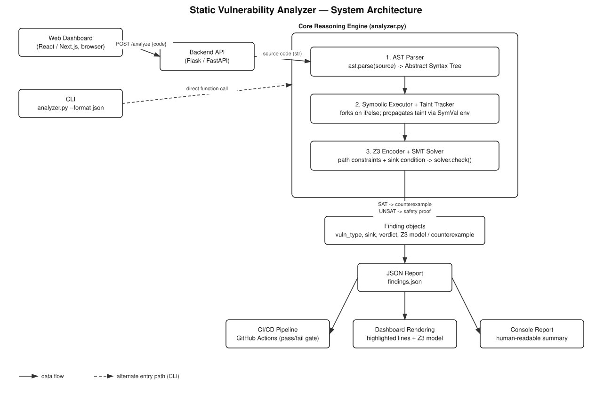
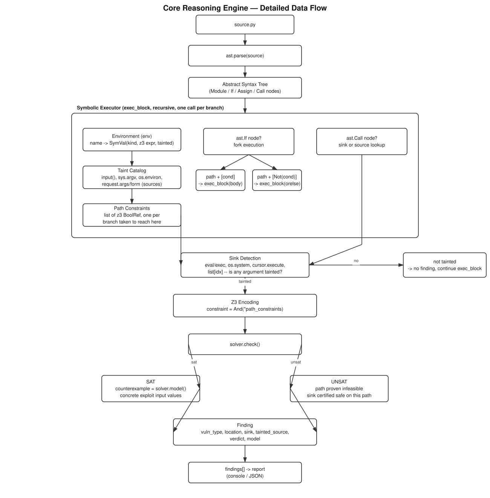

# SymGuard (AST + Taint Tracking + Z3 SMT Proofs)

> [!NOTE]
> **Research-Style Prototype Notice:** SymGuard is an exploratory static analysis prototype that proves reachable security vulnerabilities using Z3 SMT constraint solving. It does **not** provide a commercial-grade safety certification or support arbitrary Python semantics. A clean result applies only to the supported language subset and bounded loop unrolling depth.

A static analyzer that doesn't guess whether code is vulnerable — it **proves** it, using an SMT solver (Z3).

```
source.py --[ast.parse]--> AST --[symbolic execution]--> Z3 formulas --[solver]--> proof
```

## System Architecture & Dataflow



---

## How It Works

1. **Parse:** Python's built-in `ast` module turns source code into an Abstract Syntax Tree — no custom lexer or parser needed.
2. **Symbolically execute:** The engine walks the AST and builds up a *symbolic* environment: variables map to Z3 terms (`Int` or `String` theories). Every `if` **forks** execution into two independent paths: one with condition added to path constraints, one with its negation.
3. **Track taint:** Any value derived from `input()`, `sys.argv`, `os.environ.get(...)`, Flask's `request.args/form/values.get(...)`, or a function parameter annotated `: Tainted` is tracked. Taint propagates through string concatenation, f-strings, `%`-formatting, and arithmetic.
4. **Prove reachability at sinks:** When a tainted value reaches a dangerous sink (`os.system`, `eval`, `cursor.execute`, subscript indexing), the accumulated path constraint is queried against Z3:
   - **SAT** → The vulnerability is mathematically reachable. Z3 returns a concrete **counterexample** exploit payload.
   - **UNSAT** → The path is mathematically infeasible. The tool certifies that the sink is safe under the modeled semantics.
   - **UNKNOWN** → Solver timeout or unmodeled theory.



---

## Vulnerability Rules Catalog

| Rule ID | Category | Sinks Recognized | Safe Patterns |
|---|---|---|---|
| `SYM001` | OS Command Injection | `os.system`, `os.popen`, `subprocess.run/call/Popen(..., shell=True)` | List-form `subprocess` without `shell=True` |
| `SYM002` | Code Injection | `eval`, `exec` | Safe parsers (`ast.literal_eval`, `json.loads`) |
| `SYM003` | SQL Injection | `*.execute(...)` with string formatting | Parameterized query `execute(query, params)` |
| `SYM004` | Out-of-Bounds Indexing | `list_var[tainted_idx]` | Bounds checks (`0 <= idx < len(list)`) |
| `SYM901` | Loop Unrolling Note | `(loop body)` | Explicit notification of bounded iteration |

---

## Installation

### Prerequisites
- Python 3.11 or Python 3.12

### Runtime Dependencies
```bash
pip install -r requirements.txt
```

### Development & Test Dependencies
```bash
pip install -r requirements-dev.txt

# Provision the official SARIF schema for offline test validation
python scripts/fetch_sarif_schema.py
```

---

## CLI Usage

### 1. Human-Readable Report (Default)
```bash
python analyzer.py examples/command_injection.py
```

### 2. Machine-Readable JSON Report
```bash
python analyzer.py examples/command_injection.py --format json --output findings.json
```

Example JSON schema (`schema_version: "1.1"`):
```json
{
  "schema_version": "1.1",
  "tool": "SymGuard",
  "target": "examples/command_injection.py",
  "summary": { "vulnerable": 2, "safe": 0, "unknown": 0, "notes": 0 },
  "findings": [
    {
      "rule_id": "SYM001",
      "rule_name": "OS Command Injection",
      "vuln_type": "OS Command Injection",
      "location": "module:line 9",
      "line": 9,
      "column": 5,
      "uri": "examples/command_injection.py",
      "sink": "os.system(...)",
      "tainted_source": "stdin (input())",
      "path_condition": "user_input == 'safe_mode'",
      "verdict": "VULNERABLE (proven reachable by Z3)",
      "severity": "high",
      "message": "Proven reachable OS Command Injection at os.system(...) via stdin (input()).",
      "z3_counterexample": "[stdin__1 = \"safe_mode\"]"
    }
  ]
}
```

### 3. SARIF 2.1.0 Report (for GitHub Code Scanning & IDEs)
```bash
python analyzer.py examples/command_injection.py --format sarif --output findings.sarif
```

### 4. CI Gating (`--fail-on-vulnerable`)
Exit code is `1` if any proven `high` severity vulnerability is found; `0` if clean; `2` on syntax or file errors:
```bash
python analyzer.py target.py --fail-on-vulnerable
```

---

## Running Tests & Benchmark

### Automated Regression Suite (Pytest)
Run all 32 regression tests covering sources, sinks, path constraints, loop bounds, schema contracts, CLI exit codes, JSON, and official SARIF 2.1.0 schema validation:
```bash
pytest -v
```

### Reproducible Benchmark
Run the transparent benchmark corpus across vulnerable, safe, and out-of-scope cases:
```bash
python benchmark/run_benchmark.py
```
Outputs a Markdown summary and generates `benchmark/results.json`.

---

## Web Dashboard

SymGuard includes an interactive web dashboard for real-time code analysis and visualization:

```bash
python web/app.py
```

Access the UI at `http://localhost:5000` to upload or paste Python source files, explore tainted paths, and review concrete Z3 counterexamples.

---

## Documentation Links

- [Architecture Overview](docs/ARCHITECTURE.md) — Detailed design of AST parsing, symbolic value mapping, path constraints, and Z3 SMT solver queries.
- [Supported Subset & Limitations](docs/SUPPORTED_SUBSET.md) — Explicit language subset, bounded unrolling, and out-of-scope constructs.
- [Benchmark Methodology](docs/BENCHMARK_METHODOLOGY.md) — Corpus structure, evaluation protocol, and metric definitions.

---

## Bounded Loop Support

`for` and `while` loop bodies are unrolled a fixed number of times (`UNROLL_DEPTH = 3` in `analyzer.py`):
- Any vulnerability reachable within `UNROLL_DEPTH` iterations is proven with a real Z3 counterexample.
- A clean report only certifies safety up to that depth, not for arbitrarily many iterations.
- An informational note (`SYM901`) is emitted for analyzed loops to maintain transparency.

---

## Repository Files

- `analyzer.py` — Core static analyzer (AST traversal, symbolic executor, Z3 constraint solver, reporting).
- `requirements.txt` / `requirements-dev.txt` — Minimal runtime and development dependencies.
- `.github/workflows/symguard-ci.yml` — Automated CI workflow running pytest, benchmark, and artifact generation.
- `benchmark/` — Labelled benchmark corpus, runner script, and reproducible metrics.
- `diagrams/` — System architecture and engine dataflow diagrams and generators.
- `docs/` — Architecture, supported subset, and benchmark methodology documentation.
- `examples/` — Annotated sample programs demonstrating vulnerable and safe proof paths.
- `schemas/` — Official OASIS SARIF 2.1.0 JSON schema for offline validation.
- `scripts/` — Utility scripts for schema fetching and dashboard verification.
- `tests/` — Automated pytest regression suite (32 tests).
- `web/` — Web dashboard UI for interactive vulnerability exploration.
